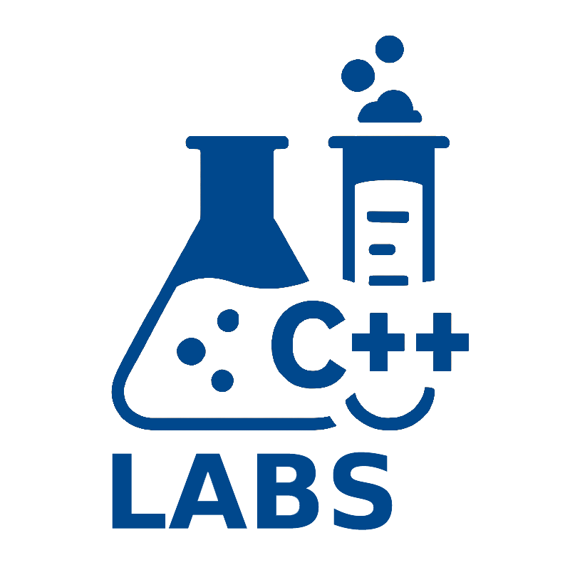

# Лабораторные по C++

## Описание
Лабораторные работы по курсу «Основы и методологии программирования».

**Язык программирования:** C++

**Автор:** [Ольга Казанцева](https://github.com/avelana)

**Начните с [SETUP.md](SETUP.md)** (один раз): там описано, как установить компилятор, CMake, VS Code и расширения (Windows, macOS, Linux) или вместо этого работать в готовом контейнере (Docker, GitHub Codespaces) и сделать свою копию репозитория.

**Затем — [WORKFLOW.md](WORKFLOW.md)** (для каждой лабораторной): как получить новую лабораторную, выполнить её в своей ветке, сдать запросом на слияние и что делать, если что-то не работает.

## Оглавление
- [Структура репозитория](#структура-репозитория)
- [Как устроена задача в лабораторных 1 и 2](#как-устроена-задача-в-лабораторных-1-и-2)
- [Как устроена задача в лабораторных с Google Test или Catch2](#как-устроена-задача-в-лабораторных-с-google-test-или-catch2)
- [Сборка и запуск](#сборка-и-запуск)
  - [Лабораторные 1 и 2](#лабораторные-1-и-2)
  - [Лабораторные с Google Test или Catch2 (с лабораторной 3)](#лабораторные-с-google-test-или-catch2-с-лабораторной-3)
  - [Сборка и запуск в терминале](#сборка-и-запуск-в-терминале)
- [Общая библиотека cpplabs — общие функции для нескольких задач](#общая-библиотека-cpplabs--общие-функции-для-нескольких-задач)
- [Как получать новые лабораторные и сдавать работы](#как-получать-новые-лабораторные-и-сдавать-работы)
- [Лицензия](#лицензия)
- [English](#english)

## Структура репозитория
**Весь репозиторий — один проект.** Все лабораторные, их задачи и общая библиотека `common/` описаны для одной системы сборки и собираются вместе, одной командой. Отдельного проекта для каждой задачи нет: каждая программа и каждый набор тестов — отдельная **цель сборки**, её и выбирают для запуска. Имена целей: программа — `lab-NN-task-NN_<задача>`, открытые тесты — `lab-NN-task-NN-tests`, ваши тесты — `lab-NN-task-NN-tests-student` (на Catch2 — `lab-NN-task-NN-tests-student-catch2`); у задач семинара вместо `task` — `seminar`. Поэтому в VS Code открывается корневая папка репозитория, а не папка лабораторной или задачи. Система сборки — одна из двух:
- **CMake** — основной способ, по нему написаны инструкции в разделе «Сборка и запуск». Корневой `CMakeLists.txt` подключает `common/` и все папки `lab-*`, поэтому новые лабораторные попадают в сборку сами;
- **Bazel** — по желанию, вместо CMake: зависимости описаны в `MODULE.bazel`, а файл `BUILD.bazel` для каждой задачи вы пишете сами ([WORKFLOW.md](WORKFLOW.md), раздел 2).

```
cpp-labs/
├── README.md                                   ← этот файл: устройство репозитория и задач, сборка и запуск
├── SETUP.md                                    ← настройка окружения и своя копия репозитория (один раз)
├── WORKFLOW.md                                 ← получение, выполнение и сдача лабораторных; решение проблем
├── GIT.md                                      ← шпаргалка по командам Git и сообщениям коммитов
├── CMakeLists.txt, CMakePresets.json, cmake/   ← сборка CMake: основной способ (не изменяйте)
├── MODULE.bazel, .bazelrc, .bazelversion       ← сборка Bazel: по желанию, вместо CMake (не изменяйте; WORKFLOW.md, раздел 2)
├── .clang-format, .clang-tidy                  ← стиль кода курса (не изменяйте)
├── .vscode/                                    ← настройки VS Code
├── .devcontainer/                              ← контейнер с инструментами курса: по желанию, вместо их установки (не изменяйте; SETUP.md, раздел 1)
├── common/                                     ← общая библиотека cpplabs: готовые функции и место для ваших (см. common/README.md)
├── lab-01_linear-algorithms/                   ← лабораторная работа 1
│   ├── README.md                               ← срок, правила сдачи, список задач
│   ├── seminar-01_cars-distance/ …             ← задачи семинара: разбираем на занятии, доделываете дома
│   └── task-01_greeting/ …                     ← задачи лабораторной работы
└── lab-02_branching-algorithms/                ← лабораторная работа 2 (и далее lab-NN_…)
```
Новые лабораторные появляются в репозитории по мере курса; уже выполненные задачи при этом не изменяются. Работают не в этом репозитории, а в своей приватной копии: как её сделать (один раз) — в [SETUP.md, раздел 5](SETUP.md#5-своя-копия-репозитория-один-раз), как получать в неё новые лабораторные — в [WORKFLOW.md, раздел 1](WORKFLOW.md#1-получить-новую-лабораторную).

## Как устроена задача в лабораторных 1 и 2
Каждая задача — отдельная программа в своей папке:
```
task-02_arithmetic/
├── README.md          ← условие задачи и описание файлов
├── CMakeLists.txt     ← сборка программы (не изменяйте)
└── src/arithmetic.cpp ← ваш код
```
Файл `src/*.cpp` устроен так:
1. **объявления функций** — уже написаны, не изменяйте их: по этим функциям преподаватель проверяет решение;
2. **функции тестирования** `testX()` — в каждой есть одна проверка `assert`; допишите свои: типичный случай, граница, ±1 от границы, «неудобный» случай;
3. **`main`** — вызовы функций тестирования уже есть; допишите ввод данных и вывод результата;
4. **определения функций** — замените заглушки `return {};` решением.

Места, где нужно писать код, отмечены комментариями `// TODO`. Пока функции не написаны, программа останавливается на первой же проверке (`Assertion failed: …`) — это ожидаемо. Когда все проверки проходят, программа переходит к вводу данных.

Между строками `// NOLINTBEGIN(readability-magic-numbers)` и `// NOLINTEND(readability-magic-numbers)` ожидаемые значения в `assert` можно писать числами. В остальном коде числа, кроме −1, 0, 1 и 2, объявляйте именованными константами.

## Как устроена задача в лабораторных с Google Test или Catch2
Начиная с лабораторной 3 код задачи разделён на несколько файлов, а проверки — тесты: открытые написаны на Google Test, свои можно писать на Google Test или Catch2:
```
task-04_lattice-points/
├── README.md                              ← условие задачи и описание файлов
├── CMakeLists.txt                         ← сборка программы и тестов (не изменяйте)
├── include/lattice_points.hpp             ← объявления функций (не изменяйте)
├── src/lattice_points.cpp                 ← ваш код: определения функций
├── src/lattice_points_main.cpp            ← ваш код: main — ввод данных, вызов функций, вывод
├── tests/open/lattice_points_test.cpp     ← открытые тесты (не изменяйте)
└── tests/student/lattice_points_test.cpp  ← ваши тесты
```
1. **объявления функций** в `include/*.hpp` — по ним преподаватель проверяет решение, не изменяйте их;
2. **определения функций** в `src/<задача>.cpp` — замените заглушки `return {};` решением;
3. **`main`** в `src/<задача>_main.cpp` — напишите ввод данных, вызов функций и вывод результата; проверок в `main` больше нет;
4. **открытые тесты** в `tests/open/` — уже написаны; пока функции не написаны, они не проходят — это ожидаемо;
5. **свои тесты** в `tests/student/` — дописывайте на Google Test или Catch2: типичный случай, граница, ±1 от границы, «неудобный» случай.

Места, где нужно писать код, отмечены комментариями `// TODO`. Код задачи без `main` собирается в библиотеку, которую используют и программа, и тесты, поэтому тесты проверяют те же функции, что вызывает ваша программа. В тестах ожидаемые значения можно писать числами: clang-tidy для них отключён. Состав файлов каждой задачи описан в её `README.md`, как собирать и запускать программу и тесты — в разделе «Сборка и запуск → Лабораторные с Google Test или Catch2».

## Сборка и запуск

> **Названия кнопок и команд** даны для английского интерфейса VS Code.
> - Расширение CMake Tools может показывать свои подписи по-русски (по языку системы) — тогда русское название указано в скобках.
> - В палитре команд (`Ctrl+Shift+P`) можно вводить и английские, и русские названия.

> **Клавиши F1–F12 в macOS** по умолчанию управляют яркостью, звуком и т. п.
> - Чтобы нажать F5, F7 и др., удерживайте клавишу **fn** (🌐): **F7** → `fn+F7`, `Control+Shift+F5` → `fn+Control+Shift+F5`.
> - Чтобы F-клавиши работали без fn, включите стандартные функциональные клавиши:
>   - **System Settings → Keyboard → Keyboard Shortcuts… → Function Keys** → **Use F1, F2, etc. keys as standard function keys**;
>   - в русской macOS: **Системные настройки → Клавиатура → Сочетания клавиш… → Функциональные клавиши** → **Использовать клавиши F1, F2 и т. д. как стандартные функциональные клавиши**.

### Лабораторные 1 и 2
**VS Code — по шагам** (на примере задачи 2 лабораторной 1):
1. **Откройте корневую папку репозитория** `cpp-labs`: **File → Open Folder…** (в macOS **File → Open…**). Именно корневую, а не папку лабораторной или задачи: иначе CMake Tools не найдёт `CMakePresets.json`.

   При первом открытии VS Code спрашивает: *Do you trust the authors of the files in this folder?* Нажмите **Yes, I trust the authors**. Если отказаться, VS Code откроет папку в ограниченном режиме (**Restricted Mode**): русские буквы в коде обводятся рамками, а CMake Tools и clang-tidy не работают, поэтому проект не соберётся. Если вы уже отказались: `Ctrl+Shift+P` (в macOS `Cmd+Shift+P`) → **Workspaces: Manage Workspace Trust** → **Trust**.
2. **Выберите пресет** (один раз). При первом открытии VS Code предложит выбрать пресет настройки (**Configure Preset**, в русском интерфейсе CMake — «предустановка конфигурации») — выберите `Debug (GCC/Clang)`, а в Windows с компилятором Microsoft — `Debug (MSVC)`. Если окно не появилось: `Ctrl+Shift+P` (в macOS `Cmd+Shift+P`) → **CMake: Select Configure Preset** (**CMake: Выбор предустановки конфигурации**). После выбора CMake настроит проект: на панели **Output** появится `Configuring done` и `Generating done`.
3. **Откройте условие и код задачи:** на панели **Explorer** — `lab-01_linear-algorithms/task-02_arithmetic/README.md` (условие) и `src/arithmetic.cpp` (ваш код).

   Файл `.md` по умолчанию открывается как текст с разметкой. Чтобы увидеть его оформленным (с таблицами, формулами и ссылками), откройте предпросмотр: `Ctrl+Shift+V` (в macOS `Cmd+Shift+V`) или кнопка **Open Preview** в правом верхнем углу вкладки. Текст и предпросмотр рядом — `Ctrl+K V` (в macOS `Cmd+K V`): сначала `Ctrl+K`, затем отпустите и нажмите `V`.
4. **Выберите программу для запуска:** откройте панель CMake — значок-треугольник CMake на панели действий (вертикальная полоса значков у левого края окна, где Explorer, Search, Run and Debug, Extensions). Если значка не видно, он может быть спрятан в «…» внизу этой полосы; панель также открывается через `Ctrl+Shift+P` (в macOS `Cmd+Shift+P`) → **View: Open View** → `CMake`. На панели CMake в разделе **Project Status** (**Состояние проекта**) найдите строку **Launch** (**Запуск**): под ней написано имя выбранной программы. Наведите на эту строку мышь — справа появится карандаш (**Set Launch Target** / **Настроить целевой объект запуска**); щёлкните по нему и выберите `lab-01-task-02_arithmetic` из списка (можно начать вводить имя). То же через палитру команд: `Ctrl+Shift+P` (в macOS `Cmd+Shift+P`) → **CMake: Set Launch/Debug Target** (**CMake: Настройка запуска/отладки целевого объекта**). Кнопка ▶ всегда запускает выбранную здесь программу. Имя программы указано в `README.md` задачи.
5. **Соберите:** кнопка **Build** (**Сборка**) на панели CMake, **F7** или `Ctrl+Shift+P` (в macOS `Cmd+Shift+P`) → **CMake: Build** (**CMake: Сборка**). Сообщения компилятора и clang-tidy появятся на панели **Problems** (`Ctrl+Shift+M`, в macOS `Cmd+Shift+M`); щелчок по сообщению открывает строку с ошибкой. Замечания clang-tidy (стиль кода по правилам `.clang-tidy`) нужно исправить. Пока функции не написаны, компилятор предупреждает о неиспользуемых параметрах (`unused parameter`) — это ожидаемо.
6. **Запустите:** кнопка ▶ в строке **Launch** (**Запуск**) на панели CMake или `Ctrl+Shift+F5` (в macOS `Control+Shift+F5`, именно Control, не Cmd) — запуск без отладки. Программа выполнится во встроенном терминале — туда же вводите данные с клавиатуры и нажимайте Enter.
7. **Посмотрите результат.** Пока функции не написаны, программа остановится на первой проверке (пример для macOS; в Linux и Windows текст немного другой):
   ```
   Assertion failed: (sum(7, 2) == 9), function testSum, file arithmetic.cpp, line 16.
   ```
   Это ожидаемо: в сообщении видно, какая проверка не прошла и в какой строке. Напишите решение вместо заглушки `return {};`, сохраните файл (`Ctrl+S`) и повторите шаги 5–6. Когда все проверки проходят, программа переходит к вводу данных.
8. **Отладка (если программа работает неправильно):** поставьте точку останова, щёлкнув слева от номера строки (появится красная точка), и нажмите **F5**. Программа остановится на этой строке; значения переменных видны на панели **Run and Debug**, **F10** — выполнить строку, **F11** — войти в функцию, **F5** — продолжить.

**Переход к другой задаче.** Открыть файл другой задачи недостаточно: ▶ по-прежнему запускает программу, выбранную в строке **Launch** (**Запуск**). Выберите там программу новой задачи (шаг 4: карандаш или **CMake: Set Launch/Debug Target**, в списке можно ввести часть имени, например `task-05`), затем соберите и запустите (шаги 5–6). Шаги 1–2 при следующих открытиях VS Code повторять не нужно.

Свои проверки `assert` дописывайте в функции тестирования `testX()` в том же файле.

### Лабораторные с Google Test или Catch2 (с лабораторной 3)
У каждой задачи три цели сборки и четвёртая — если вы пишете тесты на Catch2 (на примере задачи 4 лабораторной 3):

| Цель | Что это | Как запускать |
|---|---|---|
| `lab-03-task-04_lattice-points` | программа: ваш `main` | как программу: выбрать в **Launch** (**Запуск**), ▶ |
| `lab-03-task-04-tests` | открытые тесты `tests/open/` | панель **Testing** или `ctest` |
| `lab-03-task-04-tests-student` | ваши тесты `tests/student/` на Google Test | панель **Testing** или `ctest` |
| `lab-03-task-04-tests-student-catch2` | ваши тесты `tests/student/` на Catch2 — только если такие есть | панель **Testing** или `ctest` |

Все собираются одной сборкой вместе с остальными программами. Имена целей указаны в `README.md` задачи.

**VS Code — по шагам** (шаги 1–2 — как для лабораторных 1 и 2, если вы их ещё не делали):
1. **Откройте условие и код задачи:** на панели **Explorer** — `lab-03_loop-algorithms/task-04_lattice-points/README.md` (условие), `src/lattice_points.cpp` (решение), `src/lattice_points_main.cpp` (`main`) и `tests/student/lattice_points_test.cpp` (ваши тесты).
2. **Соберите:** кнопка **Build** (**Сборка**) на панели CMake, **F7** или `Ctrl+Shift+P` (в macOS `Cmd+Shift+P`) → **CMake: Build** (**CMake: Сборка**). Собираются все цели, в том числе тесты. Сообщения компилятора и clang-tidy — на панели **Problems**, как в лабораторных 1 и 2.
3. **Запустите тесты:** откройте панель **Testing** (значок колбы на левой боковой панели) и нажмите ▶ у теста, задачи или всего списка. Тесты задачи называются `lab-03-task-04.open.<Набор>.<Тест>` (открытые) и `lab-03-task-04.student.<Набор>.<Тест>` (ваши). Непройденные тесты отмечены красным, щелчок по тесту показывает, какая проверка не прошла и с какими значениями. Пока функции не написаны, тесты не проходят — это ожидаемо. Если список тестов пуст или устарел, нажмите ⟳ (**Refresh Tests**) вверху панели. Тесты запускают уже собранные программы, поэтому после правки кода сначала соберите (шаг 2).
4. **Запустите программу:** на панели CMake в строке **Launch** (**Запуск**) выберите `lab-03-task-04_lattice-points` (карандаш появляется при наведении мыши на строку **Launch**, или `Ctrl+Shift+P` → **CMake: Set Launch/Debug Target**, как в шаге 4 для лабораторных 1 и 2) и нажмите ▶ или `Ctrl+Shift+F5` (в macOS `Control+Shift+F5`). Данные вводите во встроенном терминале.
5. **Отладка теста:** выберите в строке **Launch** (**Запуск**) цель с тестами — `lab-03-task-04-tests`, `lab-03-task-04-tests-student` или `lab-03-task-04-tests-student-catch2`, поставьте точку останова в тесте или в функции из `src/lattice_points.cpp` и нажмите **F5**. Выполнятся все тесты этой цели, а программа остановится на точке останова. Отладка самой программы — так же, с целью `lab-03-task-04_lattice-points`.

**Свои тесты.** Пишите их в папке `tests/student/` задачи: пример лежит в `tests/student/<задача>_test.cpp`, файлов может быть несколько (`tests/student/<имя>_test.cpp`). Новый файл подхватывается при следующей сборке. В шаблоне тест-пример закомментирован, поэтому, пока вы не написали свой первый `TEST`, ваших тестов в списке нет, а `ctest` пишет `No tests were found`.
- Имена тестов могут совпадать с открытыми: можно скопировать открытый тест и изменить его — это разные программы.
- Внутри `tests/student/` одной задачи имена `TEST(Набор, Тест)` не должны повторяться: все ваши файлы собираются в одну программу, и повтор даст ошибку компоновки (`multiple definition` / `already defined`).
- Открытые тесты в `tests/open/` не изменяйте.

**Свои тесты на Catch2.** Свои тесты можно писать не только на Google Test, но и на Catch2 (тема 4.4) — в отдельном файле `tests/student/<имя>_test.cpp`. Фреймворк определяется по файлу: если в нём есть `#include <catch2/…>`, файл собирается с Catch2 в цель `<префикс>-tests-student-catch2` (например, `lab-03-task-04-tests-student-catch2`), остальные — с Google Test, как раньше. В одном файле фреймворки не смешивайте. Открытые тесты остаются на Google Test.

```cpp
// tests/student/lattice_points_catch2_test.cpp
#include <catch2/catch_test_macros.hpp>

#include "lattice_points.hpp"

TEST_CASE("Для n = 2 подходят четыре пары", "[LatticePoints]")
{
    REQUIRE(countLatticePoints(2) == 4); // (0, 0), (0, 1), (1, 0), (1, 1)
}
```

Тесты Catch2 тоже видны на панели **Testing** и запускаются командой `ctest`, с тем же префиксом `<префикс>.student.`. Catch2 CMake находит установленным или скачивает при первой настройке проекта, как Google Test.

### Сборка и запуск в терминале
То же самое без кнопок VS Code можно делать командами в терминале. Терминал — встроенный в VS Code (**Terminal → New Terminal**, `` Ctrl+` ``, в macOS `` Control+` ``) или отдельное приложение: Terminal в macOS и Linux, PowerShell в Windows. Команды выполняйте из корневой папки репозитория `cpp-labs` (во встроенном терминале VS Code вы уже в ней).

**Настройка и сборка** (настройка — один раз, сборка — после каждой правки кода):
```sh
cmake --preset debug                    # настройка проекта → build/debug
cmake --build --preset debug            # сборка всех программ и тестов (и проверка стиля clang-tidy)
```

**Запуск программы:**
```sh
./build/debug/bin/lab-01-task-02_arithmetic
./build/debug/bin/lab-03-task-04_lattice-points
```
Имя программы: `lab-<NN>-task-<NN>_<задача>` или `lab-<NN>-seminar-<NN>_<задача>`; все программы собираются в папку `build/debug/bin`.

**Запуск тестов (с лабораторной 3):**
```sh
ctest --preset debug                                # все тесты всех задач
ctest --preset debug -R "lab-03-task-04\."          # тесты задачи: открытые и ваши
ctest --preset debug -R "lab-03-task-04\.student\." # только ваши тесты задачи
./build/debug/bin/lab-03-task-04-tests              # открытые тесты напрямую: подробный вывод Google Test
./build/debug/bin/lab-03-task-04-tests-student      # ваши тесты на Google Test напрямую
./build/debug/bin/lab-03-task-04-tests-student-catch2 # ваши тесты на Catch2 напрямую
```

С компилятором Microsoft используйте пресет `msvc-debug` вместо `debug` (`cmake --preset msvc-debug`, `cmake --build --preset msvc-debug`, `ctest --preset msvc-debug`), программы окажутся в `build\msvc-debug\bin`. Пресеты `release` и `msvc-release` собирают программы без отладочной информации.

**Проверка стиля clang-tidy** без сборки — например, если вы собираете Bazel. Флаги компиляции clang-tidy берёт из файла `build/debug/compile_commands.json`, который создаёт настройка проекта (`cmake --preset debug`, один раз). Перечислите файлы задачи:
```sh
clang-tidy -p build/debug lab-04_arrays/task-01_missing-digit/src/missing_digit.cpp lab-04_arrays/task-01_missing-digit/src/missing_digit_main.cpp
```
Замечания выводятся с именем файла, номером строки и названием проверки в квадратных скобках, например `[readability-magic-numbers]`. Строки `N warnings generated` и `Suppressed N warnings (… in non-user code …)` — не замечания к вашему коду: это скрытые предупреждения в системных заголовках. С компилятором Microsoft — `-p build/msvc-debug`.

Если сборка не запускается — см. раздел «Если что-то не работает» в [WORKFLOW.md](WORKFLOW.md).

## Общая библиотека cpplabs — общие функции для нескольких задач
Функцию, нужную в нескольких задачах, можно вынести в общую библиотеку `cpplabs` — новыми файлами в подпапках `student/`:
```
common/
├── README.md                                 ← готовые функции библиотеки и как добавить свои
├── CMakeLists.txt                            ← сборка библиотеки (не изменяйте)
├── include/cpplabs/<модуль>.hpp              ← готовые модули: объявления функций (не изменяйте)
├── src/<модуль>.cpp                          ← готовые модули: определения функций (не изменяйте)
├── tests/<модуль>_test.cpp                   ← тесты готовых модулей (не изменяйте)
├── include/cpplabs/student/<модуль>.hpp      ← ваш код: объявления функций
├── src/student/<модуль>.cpp                  ← ваш код: определения функций
└── tests/student/<модуль>_test.cpp           ← ваши тесты
```
Как это сделать и какие функции в библиотеке уже есть — в [common/README.md](common/README.md).

## Как получать новые лабораторные и сдавать работы
Каждая лабораторная выполняется в отдельной ветке `lab-NN` вашей приватной копии репозитория и сдаётся запросом на слияние `lab-NN → main`, рецензент — преподаватель лабораторных. Как сделать свою копию — в разделе 5 [SETUP.md](SETUP.md), получение и сдача лабораторных — в [WORKFLOW.md](WORKFLOW.md), краткая шпаргалка по Git и сообщениям коммитов — в [GIT.md](GIT.md). Срок сдачи указан в `README.md` лабораторной.

**Не изменяйте** файлы `CMakeLists.txt`, `CMakePresets.json`, `cmake/`, `MODULE.bazel`, `.bazelrc`, `.bazelversion`, `.devcontainer/`, `.clang-format`, `.clang-tidy`, открытые тесты `tests/open/`, файлы `common/` (кроме ваших подпапок `student/`) и объявления функций: при получении обновлений в изменённых файлах возникнут конфликты, а проверка решения выполняется с исходными файлами.

## Лицензия


[CC BY-NC 4.0](https://creativecommons.org/licenses/by-nc/4.0/) — см. [LICENSE](LICENSE).

© Казанцева О. Г., 2025–2026

Заготовки, тесты и файлы сборки распространяются по CC BY-NC 4.0. Код, который вы пишете в решениях, принадлежит вам. Сохраняйте файл `LICENSE` в своей копии. Преподаватель использует ваши решения только для проверки; публикация фрагментов как примеров — только с вашего согласия.

## English
C++ labs for the course "Programming Fundamentals and Methodologies."

**Programming language:** C++

**Author:** [Olga Kazantseva](https://github.com/avelana)

**Copyright (c) 2025-2026** [Olga Kazantseva](https://github.com/avelana). Licensed under [CC BY-NC 4.0](https://creativecommons.org/licenses/by-nc/4.0/), see [LICENSE](LICENSE).

Templates, tests, and build files are licensed under CC BY-NC 4.0. The code you write in your solutions belongs to you. Keep the `LICENSE` file in your copy. The instructor uses your solutions only for grading; excerpts are published as examples only with your consent.
